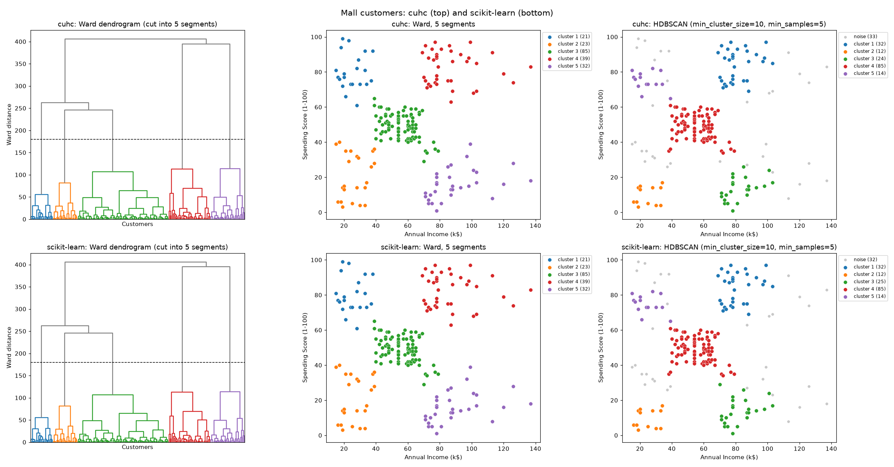

# Tutorial: customer segments

This tutorial finds groups of customers in the Kaggle "Mall Customers" data set. It uses
Ward linkage and HDBSCAN from cuhc, and compares the results with scikit-learn.

At the end, you have this figure. The top row shows cuhc, and the bottom row shows
scikit-learn:



The full script is `examples/customer_segments/cluster_customers.py` (section 8).

---

## 1. Get the data

The data set is `vjchoudhary7/customer-segmentation-tutorial-in-python` on Kaggle. It
contains one file, `Mall_Customers.csv`, with 200 customers:

```
CustomerID,Gender,Age,Annual Income (k$),Spending Score (1-100)
1,Male,19,15,39
2,Male,21,15,81
3,Female,20,16,6
```

Download the file into `~/Downloads`.

## 2. Install the packages

Install cuhc (refer to [Installation](index.md#installation)), and the packages that draw
the figure:

```bash
pip install matplotlib scipy
```

## 3. Load the features

The tutorial uses two features: the annual income and the spending score. These two
features separate the customer groups. Do not use `CustomerID` as a feature. It is only
the row number, and it changes the distances without a reason.

```python
import csv
import pathlib

import numpy as np
import cuhc

FEATURES = ["Annual Income (k$)", "Spending Score (1-100)"]

path = pathlib.Path.home() / "Downloads" / "Mall_Customers.csv"
with open(path, newline="") as f:
    X = np.array([[float(row[name]) for name in FEATURES] for row in csv.DictReader(f)])
```

`X` has 200 rows and 2 columns. cuhc accepts any NumPy array, and calculates in float32.

## 4. Build the Ward tree and draw the dendrogram

`cuhc.linkage` builds the full merge tree. The result is in the scipy format, so the
scipy `dendrogram` function can draw it:

```python
import matplotlib.pyplot as plt
from scipy.cluster.hierarchy import dendrogram

Z = cuhc.linkage(X, method="ward")

dendrogram(Z, no_labels=True)
plt.ylabel("Ward distance")
plt.show()
```

The last merges of the tree are much higher than the other merges. Thus, the data has a
small number of clear groups. A horizontal cut between the 4th and the 5th merge from the
top gives 5 groups:

```python
cut_height = (Z[-5, 2] + Z[-4, 2]) / 2
```

## 5. Cut the tree into segments

`cuhc.AgglomerativeClustering` builds the same tree and cuts it into `n_clusters`
groups:

```python
segments = cuhc.AgglomerativeClustering(n_clusters=5, linkage="ward").fit_predict(X)
print(np.bincount(segments))
```

```
[21 23 85 39 32]
```

Each customer is in one of 5 segments. The large segment (85 customers) has a medium
income and a medium spending score. The other four segments are the four combinations of
a low or high income with a low or high spending score.

## 6. Find dense groups with HDBSCAN

Ward linkage puts each customer in a segment. HDBSCAN finds dense groups, and gives the
label −1 (noise) to customers in sparse areas. You do not set the number of groups.

```python
dense = cuhc.HDBSCAN(min_cluster_size=10, min_samples=5).fit_predict(X)
print(len(set(dense) - {-1}), "groups,", np.sum(dense == -1), "noise points")
```

```
5 groups, 33 noise points
```

`min_samples` sets the number of neighbours for the density of a point. Its default is
`min_cluster_size`. With only 200 customers, the four outer segments are sparse. With
the default (`min_samples=10`), HDBSCAN finds only 3 groups and gives the label "noise" to
57 customers. With `min_samples=5`, it finds the same 5 groups as Ward linkage. The
33 noise points are customers between the groups.

## 7. Compare with scikit-learn

The same calculation with scikit-learn:

```python
from sklearn.cluster import HDBSCAN, AgglomerativeClustering
from sklearn.metrics import adjusted_rand_score

sk_segments = AgglomerativeClustering(n_clusters=5, linkage="ward").fit_predict(X)
sk_dense = HDBSCAN(min_cluster_size=10, min_samples=5, copy=True).fit_predict(X)

print(adjusted_rand_score(sk_segments, segments))
print(adjusted_rand_score(sk_dense, dense))
```

```
1.0
0.993...
```

The adjusted Rand index is 1 for identical groups. It does not depend on the numbers of
the groups.

- **Ward linkage:** the groups are identical.
- **HDBSCAN:** one customer at the edge of a group is different. cuhc gives it the label
  "noise", and scikit-learn puts it in a group. The data has only integer values, so many
  distances are equal. If distances are equal, two correct implementations can merge in a
  different sequence, and the HDBSCAN result depends on this sequence. The scikit-learn
  result also changes with the sequence of equal distances.

**Same colours for the same groups.** Each library numbers its groups in its own
sequence. To compare the plots, the script gives each scikit-learn group the number of
the cuhc group that has the most of the same customers. `scipy.optimize.linear_sum_assignment`
finds the best one-to-one match:

```python
from scipy.optimize import linear_sum_assignment

def match_labels(reference, labels):
    ref_ids = [r for r in np.unique(reference) if r >= 0]
    ids = [c for c in np.unique(labels) if c >= 0]
    overlap = np.array([[np.sum((labels == c) & (reference == r)) for r in ref_ids] for c in ids])
    rows, cols = linear_sum_assignment(-overlap)          # the largest total overlap
    mapping = {ids[i]: ref_ids[j] for i, j in zip(rows, cols)}
    return np.array([mapping.get(c, -1) for c in labels])  # noise stays -1
```

The script in section 8 also gives a new number to a group with no partner.

## 8. The full script

The script draws the figure at the top of this page. It prints:

```
200 customers, features: Annual Income (k$), Spending Score (1-100)
Ward     cuhc: 5 clusters, 0 noise | scikit-learn: 5 clusters, 0 noise | agreement (adjusted Rand index) 1.000, 0 customers labelled differently
HDBSCAN  cuhc: 5 clusters, 33 noise | scikit-learn: 5 clusters, 32 noise | agreement (adjusted Rand index) 0.993, 1 customers labelled differently
```

To run it:

```bash
python examples/customer_segments/cluster_customers.py                 # show the figure
python examples/customer_segments/cluster_customers.py --save out.png  # write a file
python examples/customer_segments/cluster_customers.py --data path/to/Mall_Customers.csv
```

```python

```
